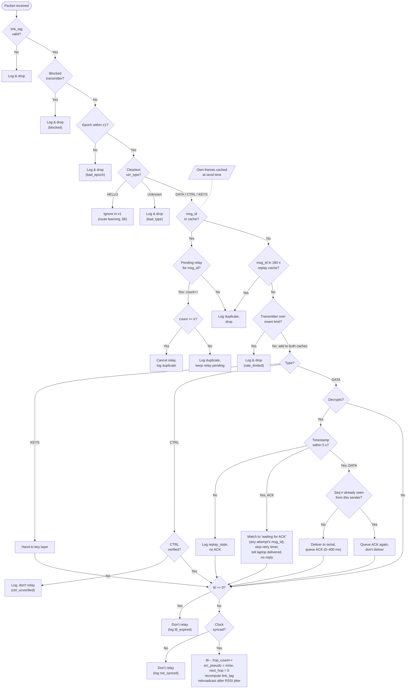
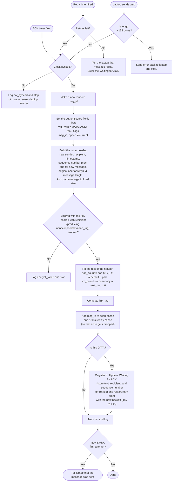

# GhostMesh Protocol

> **Status:** Draft.
> Section owners are listed under each heading. Background and rationale: [`docs/planning/project-breakdown.md`](docs/planning/project-breakdown.md).

## 1. Overview

_Owner: Rashad + Jose_

- What the protocol does, in one paragraph
- Node roles: `NODE`, `WATCHTOWER`, `ATTACKER`
- Version covered by this document (v1 flooding, v2 route learning)

## 2. Terminology

_Owner: Rashad + Jose_

- Originator, transmitter, relay, recipient
- Pseudonym, epoch
- Hop, TTL

## 3. Frame format

_Owner: Rashad + Jose (codec: Yunus)_

- Field table: name, size, cleartext or encrypted, who may change it
- Inner (encrypted) header layout
- Byte order and padding to 240 bytes

## 4. Frame types

_Owner: Rashad + Jose_

- `ver_type` values: DATA, ACK, HELLO, BLOCK
- For each type: who sends it, whether it is relayed, whether it is ACKed

## 5. Forwarding (v1: managed flooding)

_Owner: Rashad_

### 5.1 Receive rules

Code: `firmware/src/routing/routing.h` and `routing.c` (`rt_on_receive`). The log names in §5.4 match `rt_log_t`.



When a frame arrives, the node first checks the `link_tag`. If it doesn't match, the frame came from outside the network, so it's logged and dropped. Next, frames from a blocked transmitter (matched by `src_pseudo` and radio MAC, §9.8) and frames outside the ±1 epoch window (§9.2) get dropped too. HELLO frames are ignored in v1 since they're only used for route learning (§6), and unknown types are dropped. Then, the node checks the `msg_id` against its own seen cache. If it is a repeated ID, then it's logged as a duplicate and dropped, and if the node was waiting to relay that same frame, the duplicate counts towards k; once the count reaches k, the pending relay is cancelled (see Section 5.3). A `msg_id` that already fell out of the seen cache but is still in the 180 s replay cache (§9.7) is dropped as a duplicate too. Each transmitter can also only add a limited number of new `msg_id`s per second, so nobody can flush the caches (§9.9). The node also caches the `msg_id` of every frame it sends itself, so that its own frames can't loop back and be relayed. A new `msg_id` is added to both caches.

What happens next depends on the cleartext type. KEYS frames get handed to the key layer (§9.6) and then flooded like DATA. CTRL frames only get relayed if their signature verifies (§9.8). DATA frames get trial-decrypted.

If decryption works, the frame is meant for that node. Its timestamp gets checked first: anything more than 5 s off is a replay, so it's logged as `replay_stale` and gets no ACK. An ACK is matched to the node's "waiting for ACK" entry by any of its attempt `msg_id`s, which stops the retry timer and tells the laptop the message was delivered, with no reply. A second ACK for the same message finds no entry and is ignored. For a DATA frame, the node checks the sequence number against the ones it's seen from that sender recently (§9.7). If it's new, the message gets delivered to the laptop and an ACK is queued. If it's been seen, the first ACK got lost, so the node only resends the ACK. ACKs go out after a random 0–400 ms wait so their timing doesn't link the sender and recipient (§9.7). Regardless of whether or not the frame was meant for this node, it goes to the TTL check next. At `ttl == 0` the node doesn't relay it and logs `ttl_expired`. A node that hasn't synced its clock yet doesn't relay anything (§9.2). Otherwise the node decrements `ttl`, increments `hop_count`, sets its own pseudonym in `src_pseudo`, sets `next_hop` to 0, and then recomputes `link_tag`. Finally, it rebroadcasts after a random wait (depending on the RSSI).

### 5.2 Send rules

Code: `rt_send`, `build_and_send`, `retry_fire` and `ack_fire` in `routing.c`.



A node sends a frame for one of 3 reasons: 
- The laptop sends a message
- An ACK timer goes off (ACKs wait a random 0–400 ms after delivery, §9.7)
- A retry timer goes off

A message from the laptop that is over 152 bytes gets rejected with an error. If a retry has no retries left, the node tells the laptop the message failed and clears the "waiting for ACK" entry. Nothing gets sent before the node's clock syncs (§9.2): laptop sends get rejected so the firmware can queue them, and a retry that can't be sent is reported as failed. Otherwise, every send builds a new frame with a fresh random `msg_id` (including retries), so that the relays don't drop them as duplicates. The fields the encryption authenticates (`ver_type`, `flags`, `msg_id`, `epoch`) get set first, before encrypting (§9.6). The cleartext `ver_type` is always DATA, even for ACKs, so a sniffer can't tell them apart. The node then builds the inner header (real sender, recipient, timestamp, sequence #, and length), pads the message to the fixed size, and encrypts it with the key shared with the recipient. A retry keeps the original sequence number but gets a new timestamp, so the recipient can tell it's the same message.

Next, the node fills in the rest of the cleartext header (`ttl`, `hop_count`, `src_pseudo` = its own pseudonym, `next_hop` = 0) and computes the `link_tag` last, since it covers the finished header. With hop padding (§9.9), the node starts `hop_count` at a random 0–2 and lowers `ttl` by the same amount, so the first hop doesn't give away who the originator is. It also **adds its own `msg_id` to the seen_cache** (and the 180 s replay cache) so that the echo gets dropped. A DATA frame registers or updates a "waiting for ACK" entry (storing the text, recipient, & sequence # for retries) and restarts the retry timer at the next backoff (1s / 2s / 4s, and the last attempt waits 4s again before giving up). ACKs skip this, since they never get acknowledged. Finally, the frame is transmitted right away and logged, and only the first attempt of a new DATA message tells the laptop it was sent.


### 5.3 Relay timing

**Jitter:** Before rebroadcasting, a relay would wait a random time within the jitter window (where a weaker RSSI would mean a shorter wait, so farther nodes would relay first). _Exact RSSI-to-wait mapping: TBD._

**Rebroadcast suppression:** While a relay is pending, the node would count copies of the same `msg_id` that it hears from other nodes. The copy that started the timer wouldn't count though. If the count reaches a value of **k**, the node would cancel its relay. Otherwise it rebroadcasts when the timer hits. (This is inspired by [RFC 6206](https://www.rfc-editor.org/rfc/rfc6206))

**Timing rule:** The jitter window must be at least 2-3x the airtime of k frames, so that a node has time to hear k copies before the timer hits. This is inspired by [RFC 6206 Section 6.6](https://www.rfc-editor.org/rfc/rfc6206#section-6.6), where Trickle sets it up as the protocol having the minimum interval be at least 2-3 times as long as it takes to transmit k packets.

**Originator:** the node that creates a frame sends it right away. Only relays use the jitter wait.

### 5.4 Drop reasons

Every way a frame can be dropped or not relayed, with its log name (`rt_log_t` in `routing.h`).

| Log name | Path | Meaning |
|---|---|---|
| `RT_LOG_BAD_LINK_TAG` | receive | `link_tag` didn't verify: an outsider's or tampered frame |
| `RT_LOG_BLOCKED` | receive | transmitter matches an active BLOCK (§9.8) |
| `RT_LOG_BAD_EPOCH` | receive | epoch outside the ±1 window (§9.2) |
| `RT_LOG_BAD_TYPE` | receive | unknown cleartext `ver_type` |
| `RT_LOG_HELLO` | receive | HELLO frame, ignored in v1 |
| `RT_LOG_DUPLICATE` | receive | `msg_id` already seen (seen cache or 180 s replay cache), no relay pending |
| `RT_LOG_DUP_COUNTED` | receive | duplicate counted toward k, relay still pending |
| `RT_LOG_RELAY_CANCELLED` | receive | duplicate count reached k, pending relay cancelled |
| `RT_LOG_RATE_LIMITED` | receive | transmitter over the cache-insertion limit (§9.9) |
| `RT_LOG_CTRL_UNVERIFIED` | receive | CTRL frame didn't verify, not relayed (§9.8) |
| `RT_LOG_REPLAY_STALE` | receive | timestamp more than 5 s off: not delivered, no ACK (§9.7) |
| `RT_LOG_TTL_EXPIRED` | receive | `ttl == 0`, not relayed |
| `RT_LOG_NOT_SYNCED` | both | clock not synced yet, nothing transmitted or relayed (§9.2) |
| `RT_LOG_TOO_LONG` | send | laptop message over 152 bytes |
| `RT_LOG_ENCRYPT_FAILED` | send | encryption failed (unknown recipient, or no keys yet) |
| `RT_LOG_SEND_FAILED` | send | out of retries, laptop told the message failed |
| `RT_LOG_PEER_EVICTED` | both | peer table full (`RT_MAX_PEERS`), least recently used peer forgotten. Safe while a node hears from fewer than 8 senders in any 15 s window (§9.7); if duplicates appear alongside it, that limit was hit |

Normal (non-drop) events: `RT_LOG_RELAY_SCHEDULED`, `RT_LOG_TX`, `RT_LOG_DELIVERED`, `RT_LOG_REACK`, `RT_LOG_ACK_MATCHED`, `RT_LOG_ACK_UNMATCHED`.

## 6. Routing (v2: route learning)

_Owner: Rashad_

- HELLO beacons and the neighbor table
- Reverse-path route learning
- Directed forwarding with `next_hop`
- Flood fallback and self-healing
- Behaviour at epoch boundaries

## 7. Reliability

_Owner: Rashad (ACK contents: with Jose)_

- ACK contents and how an ACK travels back
- Retries and backoff
- Duplicate delivery on retry
- Delivery status reported to the chat client

## 8. Topology control

_Owner: Rashad_

- RSSI gate
- TX power
- Allowlist fallback and where it may be used

## 9. Security

_Owner: Jose_

> **Status:** decided by Network #2. Items marked ⚑ change the shared frame format or `ver_type` list and
> need team sign-off. Rationale for every choice: [`security/protocol-design-motivation.md`](security/protocol-design-motivation.md);
> decision log and open items: [`docs/planning/project-breakdown.md` §4.7](docs/planning/project-breakdown.md).
> **Byte order:** big-endian for every multi-byte field. **Hash:** keyed BLAKE2b (Monocypher /
> Python `hashlib.blake2b`), with the output length set by `digest_size`, never by truncation.

### 9.1 Keys and who holds them

| Key | Size | Held by | Purpose |
|---|---|---|---|
| `network_key` | 32 B | all nodes + watchtower | `link_tag` (9.4) |
| `pseudo_secret` | 32 B per node | that node + watchtower | pseudonym and MAC derivation (9.3); lets the watchtower map frames to real nodes |
| X25519 static key pair | 32 B + 32 B per node | private: that node; public: all nodes | root key per pair (9.6) |
| Ed25519 key pair | 32 B + 32 B | private: watchtower only; public: all nodes | signs CTRL frames (9.8) |

All keys come from `security/keygen.py` (OS randomness only) as one secret header per board in
`firmware/config/keys/` (gitignored). The watchtower never holds X25519 private keys, so it can tell **who**
transmitted but can't read messages. Node IDs: A=1, B=2, C=3, D=4, W=5 (watchtower), X=6 (insider attacker,
keyed like any node).

**Fingerprints:** `1a2b-3c4d` = first 4 bytes of `BLAKE2b("GM-FP" || key)` over each node's X25519 public key, the
watchtower's Ed25519 public key and the network key. keygen writes them to the public
`firmware/config/roster.json`; every board prints `gm_fingerprint()` of the keys it loaded at boot, and the two must match.

### 9.2 Clock and epochs

- **Mesh clock:** Unix time in ms. The IPS laptop sets the watchtower's clock over serial, and the watchtower
  floods a signed **TIME** CTRL frame every 10 s (9.8).
- **Nodes** only move their clock forward: `clock = max(local, issued_at_ms)`. Corrections under 1 s are
  spread over ~5 s. `last_beacon_ms` is saved to NVS each epoch. If no valid beacon arrives for 30 s, the node
  prints the serial event `no_beacon` and keeps running on its own clock.
- **Epoch:** `epoch = floor(unix_s / 60) mod 65536` (60 s). Every node rotates its pseudonym **and** MAC at the
  same moment.
- **Accepted epochs:** previous, current, next (±1). Relays and recipients drop anything else.
- **Before first sync:** a node receives and decrypts but doesn't transmit or relay. Laptop sends are
  queued (max 8; rejected when full).

### 9.3 Pseudonyms and MAC rotation

```
pseudo = BLAKE2b(key=pseudo_secret, digest_size=4, "GM-PSEUDO" || epoch_be16)
mac    = BLAKE2b(key=pseudo_secret, digest_size=6, "GM-MAC"    || epoch_be16)
mac[0] = (mac[0] & 0xFC) | 0x02          # locally administered, unicast
```
- Reserved pseudonyms: `0x00000000` (the flood marker in `next_hop`) and `0xFFFFFFFF`. If the hash produces one,
  rehash with a counter byte appended (`… || 0x01`, `0x02`, …).
- The watchtower derives every node's pseudonym and MAC each epoch, tags each log line with
  `"node"` (`A`–`D`, `X`, or `?`), and can check that a frame's MAC matches its pseudonym.
- Test vector: `pseudo_secret = 00 01 … 1f`, epoch `0x0102` → pseudo `ac341587`, MAC `6a:a7:07:ca:0e:dd`.

### 9.4 `link_tag`, cleartext fields

```
link_tag = BLAKE2b(key=network_key, digest_size=8, "GM-LINK" || frame[0:22] || frame[30:240])
```
- Covers **every byte except the tag itself**, so outsiders can't change any field or swap the body.
- Computed **last** by the sender and by every relay (relays rewrite `src_pseudo`, `ttl`, `hop_count` and
  `next_hop`). Verified **first** on receive, with a constant-time compare. On failure: drop and log `BAD_LINK_TAG`.
- Frame offsets: `ver_type` 0, `flags` 1, `msg_id` 2–9, `ttl` 10, `hop_count` 11, `src_pseudo` 12–15,
  `next_hop` 16–19, `epoch` 20–21, `link_tag` 22–29, `nonce` 30–53, `ciphertext` 54–223, `aead_tag` 224–239.
- Test vector: `network_key = 20 21 … 3f`, frame byte *i* = *i* → `152ee8ad612ca586`.
- `flags`: bit 0 = SOS (left in cleartext so relays can prioritise it). All other bits are 0. ⚑ The §4.1
  "needs-ACK" flag is removed, because it would reveal DATA vs. ACK.
- ⚑ Cleartext `ver_type` values: **DATA, HELLO, CTRL, KEYS** (numbers TBD with Rashad). ACKs are sent as
  DATA, and BLOCK is now a CTRL subtype.

### 9.5 Inner header (inside the 170-byte ciphertext)

| Bytes | Field | Notes |
|---|---|---|
| 0–3 | `sender_id` | real node ID |
| 4–7 | `recipient_id` | real node ID |
| 8–11 | `timestamp_ms` | mesh clock, mod 2³²; fresh on every attempt |
| 12–15 | `seq` | per sender→recipient; random start each boot |
| 16 | `type` | DATA or ACK (the real type; cleartext always says DATA) |
| 17 | `len` | ≤ 152 for DATA, 8 for ACK |
| 18–169 | `body` | ⚑ **152 bytes max** (not 153), zero-padded. ACK body = the acknowledged attempt's `msg_id` |

After decrypting, the recipient checks that `recipient_id` is itself and that `sender_id` is the peer whose key worked.

### 9.6 End-to-end encryption: epoch DH ratchet

- **Root key per pair:** `root = BLAKE2b(32, "GM-ROOT" || X25519(sk_me, pk_peer) || pk_lo || pk_hi)`.
- **Chain start / resync:** `ck[e] = BLAKE2b(key=root, 32, "GM-RESYNC" || e_be16)`.
- **Each epoch e:** every node makes a fresh X25519 key pair `r(e+1)` and floods its public half in a **KEYS**
  frame about every 10 s, along with a confirmation hash of each peer key it has received.
- **Boundary e → e+1 (chained DH):** `ck[e+1] = BLAKE2b(key=ck[e], 32, "GM-CHAIN" || (e+1)_be16 || DH)`,
  where `DH = X25519(r_me(e+1).sk, r_peer(e+1).pk)`. The DH is included only if this node holds the peer's key
  **and** the peer has confirmed holding ours; otherwise `DH` is empty. A node that can compute both versions
  keeps the other one as an alternate. If a peer's KEYS tag or message verifies under it, **the DH version wins**.
  An unresolved alternate is carried through later hash-only boundaries (stepped the same way), so a split
  can still converge after silent epochs.
- **Missed boundaries:** a node that missed epochs (off, rebooted) steps each one hash-only, up to **10**; for a
  longer gap it RESYNCs every peer.
- **Message key:** `mk[e] = BLAKE2b(key=ck[e], 32, "GM-MSG")`. AEAD: XChaCha20-Poly1305 with a random
  24-byte `nonce`; associated data `ver_type || flags || msg_id || epoch` (`frame[0:10] || frame[20:22]`).
- **Trial decryption:** every DATA frame that passes `link_tag` is tried with each peer's `mk` for the
  frame's epoch (plus the alternate at a boundary). That's usually 8–16 tag checks, with no X25519 per frame.
- **Deletion:** keep `ck` for the current and previous epoch only, and wipe `r(e).sk` once epoch e+1 has passed.
  The state is exported as a fixed, versioned ~1.5 KB blob (`gm_state_export`) and saved to NVS whenever it changes
  (at least once per epoch). Static keys stay on the board (RESYNC needs them).
- **KEYS frame** ⚑ (flooded like DATA). In the 170-byte `ciphertext` field: `target_epoch`(2) ‖ `mode`(1: 0 normal /
  1 resync) ‖ `next_pk`(32) ‖ [resync only: `nonce`(8)] ‖ 8 slots × [`tag`(8) ‖ `conf`(4)]. The slots start at byte 35
  (normal) or 43 (resync). The rest of the field, plus the frame's `nonce` and `aead_tag`, is random.
  `tag[P] = BLAKE2b(key=ck[e][me,P] (root in resync mode), 8, "GM-KEYS" || target_epoch || mode || [nonce] || next_pk || conf)`;
  `conf = BLAKE2b(4, "GM-CONF" || peer's r(e+1) pk)`. Slots are in random order, and unused slots are random bytes.
  Normal frames announce `target_epoch = e+1`. A node **ignores KEYS frames carrying its own `next_pk`** (its own echo),
  because pair keys are symmetric and its tags would otherwise verify.
- **RESYNC:** triggered when an expected peer's KEYS haven't verified for 2 epochs **and** an unverifiable KEYS frame
  was heard recently (the sign of a split chain, so a powered-off peer doesn't trigger it). Also sent on first boot
  and after a gap of more than 10 epochs. The node resets its own side with the chain-start formula and floods a
  KEYS frame in resync mode (`target_epoch` = current or previous epoch, random 8-byte nonce) 3 times. The receiver
  resets too. Limits: at most one per pair per 5 epochs, **unless the pair is already silent** (2+ epochs without a
  verified KEYS frame, which avoids deadlock when boards boot at different times). Repeated nonces are ignored. Serial event `resync`.
- **Alerts:** if a pair has had no DH step for 3 epochs, print the serial event `no_dh`.

### 9.7 Replay protection (outermost first)

1. Relays: `link_tag`; the 60 s seen-cache; a separate **180 s cache of `msg_id`s only** (~512 entries).
2. Epoch window ±1, with `epoch` bound in the AEAD associated data.
3. Key deletion: frames older than ~2 epochs can't be decrypted.
4. Recipient freshness: accept DATA only if `|now − timestamp_ms| ≤ 5 s`. Stale: drop silently, log
   `REPLAY_STALE`, **no ACK**.
5. Recipient duplicate check: seqs seen per peer in the last **15 s** (set membership). Fresh and new: deliver
   and ACK. Fresh but already seen: ACK again only.
- Retries: new `msg_id`, **same seq, new timestamp**. ACKs are sent after a random 0–400 ms delay.

### 9.8 Signed control frames (CTRL) ⚑

- Ed25519 (RFC 8032), signed by the watchtower over `"GM-CTRL" || subtype || issued_at_ms || payload`.
- Layout in the 170-byte region: `subtype`(1) ‖ `issued_at_ms`(8) ‖ payload ‖ `sig`(64). The rest of the
  region, `nonce` and `aead_tag` are random.
  - **TIME:** no payload. Accepted only if newer than `last_beacon_ms` (9.2).
  - **BLOCK:** `block_id`(4) ‖ `until_ms`(8) ‖ `reason`(1: flood/replay/spoof/routing/manual) ‖ 2 ×
    [`pseudo`(4) ‖ `mac`(6) ‖ `epoch`(2)], one entry for the current epoch and one for the next. Re-issued every
    epoch while active. Re-issuing with `until_ms = issued_at_ms` ends it early.
- **Block matching:** a frame matches if `src_pseudo` matches **and** either its radio MAC matches or the target
  MAC is all zeros. Matching frames are dropped right after the `link_tag` check and never relayed; log `BLOCKED`.
- **Verify limits:** skip, without verifying, anything not newer than what the node already holds. Beyond that,
  verify at most ~2 frames/s overall and 1 per 5 s per transmitter (`src_pseudo` + MAC). **Only verified CTRL
  frames are relayed.**

### 9.9 Flood hardening

- **Hop padding:** the originator sends with `hop_count = pad` and `ttl = default_ttl − pad`, where `pad` is
  random in {0, 1, 2}. `hop_count + ttl` stays constant, so the padding can't be seen.
- **Cache insertion limit:** each transmitter (`src_pseudo` + MAC) may add at most ~20 new `msg_id`s per second
  to the relay caches. Beyond that its frames are dropped (value to confirm with the sim).

### 9.10 Known limitations

Documented, not fixed:
- On a quiet mesh, timing can still reveal who originated a message and pair senders with recipients (O1/O2 residual).
- RSSI can track static boards across epochs (O3).
- The network's existence is visible (O7).
- The SOS bit in `flags` is cleartext (6d).
- An attacker copying a node's pseudonym **and** MAC can only be told apart by RSSI and the operator. The IPS never
  auto-blocks on spoof-like evidence; the operator confirms and only the (pseudo, MAC) pair is blocked (O9, closed by 12c).
- No network-key revocation, keys unencrypted in flash, unauthenticated serial ports, and a single jammable
  channel (O14–O17, accepted in 12a). Key fingerprints are checked at boot (O13, closed by 15).
- Open: in the 4-board setup relay D also holds the watchtower's secrets (O21); HELLO/KEYS cadence reveals how many
  nodes are active (O22).
- KEYS `conf` hashes are unkeyed, so a sniffer can recover the pair-key graph. With all-to-all provisioning it is
  complete and adds only peer counts (O23, accepted in 12d; keyed `conf` is future work).
- No protection against an attacker who holds a stolen chain or static key and actively forges KEYS frames.
- Not quantum-resistant.

## 10. Serial protocol (node ⇄ laptop)

_Owner: Yunus. Implemented in `firmware/src/node_serial.cpp` + `main.cpp` (nodes), `firmware/src/watchtower/main_w.cpp` (W),
event text in `firmware/src/node/gm_node.c` and `firmware/src/watchtower/gm_watch.c`. Reference client: `tools/chat_client.py`._

### 10.1 Rules

| # | Rule |
|---|---|
| D1 | USB serial (the S3's native USB; the baud setting is ignored). **One JSON object per line**, UTF-8, `\n`-terminated, ≤ 1 KB. Lines that don't start with `{` are debug output: ignore them. |
| D2 | **Opening (or closing) the port can reset the board**, which wipes the watchtower's clock. Open with DTR and RTS low (`s = serial.Serial(); s.port = P; s.dtr = False; s.rts = False; s.open()`), but on Windows the driver may still reset it (Nov 18). So: **a host talking to W re-sends `set_time` whenever W reports `warning clock_not_set`**, and keeps one session open where it can. |
| D3 | Three kinds of line: **commands** (laptop → board) have `"cmd"`; **events** (board → laptop) have `"ev"`; **watchtower frame lines** have neither and follow §11 / `ips/schema.py`. |
| D4 | Boards are named by **letter** on serial: `"A"`–`"D"` nodes, `"W"` watchtower, `"X"` attacker. Numeric ids appear only inside frames. |
| D5 | Watchtower frame lines carry `t` = **mesh clock**, unix seconds with ms precision. Before W's clock is set, `t` is local boot time (`t < 1e9`) and `node` is `"?"`: drop those lines. Laptop tools stamp their own arrival time (the IPS adds `rx_t`). |
| D6 | Both sides **ignore unknown fields**, so new fields never break an older reader. An unknown command gets `{"ev":"error","reason":"unknown_cmd"}`. |
| D7 | A board prints **nothing** when no host has the port open (output isn't buffered). Nodes on power banks never stall; logs only cover connected time, so **W must stay connected**. |
| D8 | Commands marked **bench** exist for testing without W and are compiled out of the demo build. |

### 10.2 Node commands (A–D)

| Command | Fields | Reply |
|---|---|---|
| `send` | `to` (letter), `text` (≤ 152 bytes UTF-8) | `sent`, later `delivered` or `failed`. Before the clock syncs: `queued` (up to 8 wait) |
| `status` | | `status`, `radio` |
| `auto` | `to` (letter, `""` = off), `every_s` (0 = off) | `auto`. Sends `auto <me>#<n>` to `to` every `every_s` s once synced. **Saved in flash.** |
| `verbose` | `on` (bool) | none. On: print every routing log event, not just the important ones |
| `txpower` | `qdbm` (8–84, quarter-dBm; 8 = 2 dBm) | `radio`. Saved |
| `rssi_gate` | `dbm` (−127 = off) | `radio`. Saved. Frames weaker than this are dropped before routing |
| `allow` | `macs` (list of `"aa:bb:cc:dd:ee:ff"`, empty = off) | `radio`. Only frames from these MACs reach routing. Use with MAC rotation off. Not saved |
| `rotate_mac` | `on` (bool) | `warning` `reboot_to_apply_rotate_mac`. Saved |
| `wipe_state` | | `state_wiped`, reboots. Clears the saved ratchet state (after re-running keygen) |
| `reboot` | | reboots |
| `set_time` **bench** | `unix_ms` | `debug_time`. Sets the clock as if a TIME beacon arrived |

### 10.3 Node events

| Event | Fields | When |
|---|---|---|
| `boot` | `name`, `id`, `fw`, `peers`, `fp{self,network,watchtower}` | after reset. Compare `fp` with `firmware/config/roster.json` |
| `synced` | `epoch`, `mac_outage_us` | clock synced for the first time since boot |
| `epoch` | `epoch`, `pseudo`, `mac_outage_us` | every epoch change (new pseudonym + MAC) |
| `queued` | `to`, `waiting` | `send` before sync |
| `sent` / `delivered` / `failed` | `to`, `handle` | first transmission / ACK received / out of retries |
| `rx` | `from`, `text`, `seq`, `rssi` | a message for this node |
| `log` | `what`, `msg_id`, `ttl`, `hop` | routing event (names = `rt_log_t`, §5.4). Always for `bad_link_tag`, `bad_epoch`, `blocked`, `ctrl_unverified`, `replay_stale`, `rate_limited`, `too_long`, `encrypt_failed`, `peer_evicted`; all of them with `verbose` |
| `block` / `unblock` | `block_id`, `pseudo`, `reason` / `block_id` | a signed BLOCK applied / ended |
| `no_beacon` | `secs` | no TIME beacon for 30 s |
| `no_dh` / `resync` | `peer` | §9.6 alerts for that peer |
| `first_beacon` | | first TIME beacon taken by the unsynced-node workaround (decision log, Nov 17) |
| `auto` | `to`, `every_s` | after the `auto` command |
| `status` | `name`, `synced`, `mesh_ms`, `epoch`, `pseudo`, counters (`rx`, `tx`, `keys_sent`, `beacons`, `delivered`, `acked`, `failed`, `relayed`, `dup`, `cancelled`, `bad_link_tag`, `bad_epoch`, `blocked`, `not_synced`, `stale`, `rate_limited`, `gate_drops`, `allow_drops`), `queued`, `mac_outage_us` | `status` |
| `radio` | `airtime_avg_us`, `rx_overflow`, `tx_fail`, `free_heap`, `rotate_mac`, `rssi_gate`, `allow_n`, `auto_to`, `auto_every_s` | `status` and settings commands |
| `oled` | `present`, `addr` | at boot |
| `debug_time` | `accepted`, `unix_ms` | `set_time` (bench) |
| `warning` / `error` | `reason` (+ details) | see 10.6 |

### 10.4 Watchtower commands (W)

| Command | Fields | Reply |
|---|---|---|
| `set_time` | `unix_ms` | `clock_set`. Starts the mesh clock; TIME beacon every 10 s from then on. W nags with `warning clock_not_set` every 5 s until it gets one |
| `status` | | `status`, `radio` |
| `block` | `node` (letter, or `"?"` with `pseudo` + `mac`), `reason` (`flood`/`replay`/`spoof`/`routing`, else 0), `until` (unix **seconds**, float; default now + 120 s) | `block_queued`, then `block_sent` within ≤ 3 s. Node blocks are re-issued every epoch (they follow the node across rotation); `?` pair blocks end at the next rotation (O9). Same format as `ips/schema.py` `make_block_cmd` |
| `unblock` | `node`, or `"?"` + `pseudo` + `mac` | `unblock_sent` (or `error no_such_block`) |
| `txpower` | `qdbm` | none. Saved |
| `reboot` | | reboots (the clock is lost: send `set_time` again) |

W sends at most one CTRL frame per 3 s (unblock, then block, then beacon), so a BLOCK can wait up to 3 s
and a beacon can slip by up to 3 s (decision log, Nov 17).

### 10.5 Watchtower events

| Event | Fields | When |
|---|---|---|
| (frame line) | §11 fields + `node`, `id_ok`, `epoch`, `flags`, `rx_us`, `rate`, `sig_mode`, `mcs`, `raw` | **every frame W hears**, including relayed copies of its own beacons (`node: "W"`) |
| `boot` | `name`, `id`, `fw`, `peers`, `mac`, `fp{self,network,watchtower}` | after reset |
| `clock_set` | `unix_ms`, `epoch` | `set_time` |
| `epoch` | `epoch`, `blocks_reissued` | every epoch change |
| `block_queued` / `block_sent` / `unblock_sent` | `block_id`, `node` / + `reason`, `until_ms` / `block_id` | BLOCK lifecycle |
| `status` | `name`, `clock_set`, `mesh_ms`, `epoch`, `frames`, `beacons`, `blocks_sent`, `unknown`, `bad_link_tag`, `nodes{<letter>:{frames,rssi}}` | `status` |
| `radio` | `airtime_avg_us`, `rx_overflow`, `tx_fail`, `free_heap` | `status` |

BLOCK `reason` codes inside the frame: 0 other, 1 flood, 2 replay, 3 spoof, 4 routing.

### 10.6 Errors and warnings (`reason`)

| Board | Reasons |
|---|---|
| any | `bad_json`, `unknown_cmd`, `cmd_queue_full`, `line_too_long`, `espnow_init_failed`, `set_mac_failed` (+`esp_err`) |
| node | `bad_to`, `too_long`, `unknown_peer`, `busy` (8 messages already waiting for ACKs), `queue_full`, `bad_unix_ms`, `timer_table_full`, `add_peer_failed`, `state_import_failed`; warnings `allowlist_needs_rotate_mac_off`, `reboot_to_apply_rotate_mac` |
| W | `bad_node`, `pair_block_needs_pseudo`, `unknown_node`, `clock_not_set`, `block_table_full`, `no_such_block`, `ctrl_sign_failed`, `bad_unix_ms`; warning `clock_not_set` |

### 10.7 Laptop-side extras (`tools/chat_client.py`)

Not part of the board protocol, but written into `--log` files: `{"ev":"mark","t":<laptop unix s>,"note":"..."}`
for ground-truth notes (`/mark`, and automatically on `/block` / `/unblock`).

## 11. Watchtower log schema

_Owner: Hannan (frozen at design freeze; everyone depends on it)_

- Field list with types (reference implementation: `ips/schema.py`)
- Meaning of `pseudo` (transmitter)
- Optional fields, such as sim ground-truth labels

## 12. Parameters

_Owner: Rashad + Jose_

| Parameter | Value | Notes |
|---|---|---|
| Default TTL (hardware) | TBD | |
| Default TTL (sim) | 16 | From the sim's `ttl_sweep` (commit `72c8408`): 50-node meshes need 14–16 to reach almost everyone, 20 nodes are already saturated at 12. Includes the +2 for hop padding. See `docs/results/sim-results.md` |
| Seen-cache size | TBD | |
| Seen-cache expiry | TBD | |
| Relay jitter window | TBD | Planned 10–50 ms. Must be at least 2–3× the airtime of k frames |
| Suppression threshold k | 2 | From the sim's `k_sweep` (50 nodes, 300 and 1000 kbps, commit `72c8408`): k = 1 loses messages to coverage holes; k = 3 cuts tail latency but costs more transmissions and collisions. See `docs/results/sim-results.md` |
| Frame airtime | TBD | Estimated ~3 ms per 240-byte frame at 1 Mbps; measure on hardware later |
| HELLO interval | TBD | |
| Neighbor expiry | TBD | |
| ACK timeout / retries / backoff | TBD | |
| Epoch length | 60 s | `floor(unix_s / 60) mod 65536` (§9.2) |
| Jitter random share | 50% | From the sim's `jitter_sweep` (50 nodes, 1000 kbps, commit `71f7fd0`): fewest collisions of 12 / 25 / 50% with the same delivery, at a small cost in median latency. The 20 ms random part is still 2–3 frame airtimes at 300 kbps (§5.3 timing rule) |
| Accepted epoch window | ±1 epoch | §9.2 |
| Pre-sync send queue | 8 messages | Rejected when full (§9.2) |
| TIME beacon interval | 10 s | Watchtower; alert after 30 s without one (§9.2) |
| Clock slew | corrections < 1 s spread over ~5 s | Clock never moves backward (§9.2) |
| KEYS interval | ~10 s (≈ 6 per epoch) | §9.6 |
| Missing-DH alert | 3 epochs | §9.6 |
| RESYNC trigger / limit | 2 epochs without a valid KEYS / max 1 per pair per 5 epochs | §9.6 |
| Long relay `msg_id` cache | 180 s, ~512 entries | §9.7 |
| Recipient freshness | 5 s | §9.7 |
| Recipient seq memory | 15 s, ~16 per peer | §9.7 |
| ACK delay | random 0–400 ms | §9.7 |
| CTRL verify budget | ~2/s global, 1 per 5 s per transmitter | §9.8 |
| Hop padding | 0–2 | Raise default TTL by 2 to keep range (§9.9) |
| Cache insertion limit | ~20 new `msg_id`/s per transmitter | Confirm with sim (§9.9) |
| Body max | 152 bytes | §9.5 |
| Missed-epoch catch-up | up to 10 hash-only steps | Longer gap → RESYNC (§9.6) |
| Persisted crypto state | 1517 bytes (`GM_STATE_BYTES`) | Versioned blob, up to 8 peers (§9.6) |

## 13. Metric definitions

_Owner: Rashad_

**Transmission:** every frame a node puts on the air, including originals, relays, ACKs, ACK relays and retries, whether or not it collided. Relays cancelled by k-suppression are not transmissions. Control traffic (KEYS, CTRL, HELLO) is counted and reported separately.

**Sent:** a laptop message accepted by `rt_send` (a non-zero handle). Messages rejected at send time (too long, not synced, table full) are not sent and are reported separately.

**Delivered:** the first time a sent message reaches its recipient's laptop. Counted once per message, no matter how many attempts or copies arrive.

**Delivery ratio:** delivered ÷ sent. A message still undelivered when the run ends (traffic window plus drain time) counts as not delivered.

**Latency:** time from the sender's `rt_send` call to delivery at the recipient, for delivered messages only. Includes any time spent on retries. Reported as median and 95th percentile, not just the mean.

**Transmissions per delivered message:** total transmissions in the run (including those spent on messages that failed) ÷ number of messages delivered.

**Reroute time:** _TBD (needed for the unplug-B test)._

## 14. Open questions

- Items still undecided, each with an owner

## 15. Decision log

- See [`docs/planning/project-breakdown.md` §4.7](docs/planning/project-breakdown.md) until decisions move here
