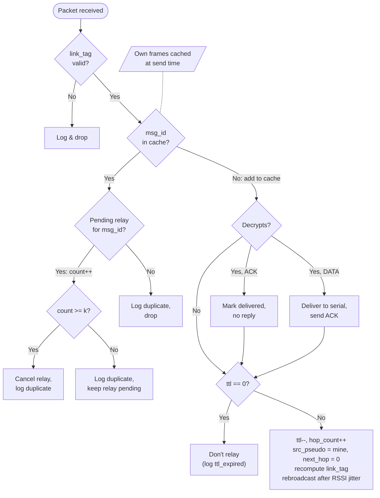

# GhostMesh Protocol

> **Status:** Draft.
> Section owners are listed under each heading. Background and rationale: [`docs/planning/project-breakdown.md`](docs/planning/project-breakdown.md).

## 1. Overview

_Owner: Rashad + Jose_

- What the protocol does, in one paragraph
- Node roles: `NODE`, `WATCHTOWER`, `ATTACKER`
- Version covered by this document (v1 flooding, v2 route learning)

## 2. Terminology

_Owner: Rashad + Jose_

- Originator, transmitter, relay, recipient
- Pseudonym, epoch
- Hop, TTL

## 3. Frame format

_Owner: Rashad + Jose (codec: Yunus)_

- Field table: name, size, cleartext or encrypted, who may change it
- Inner (encrypted) header layout
- Byte order and padding to 240 bytes

## 4. Frame types

_Owner: Rashad + Jose_

- `ver_type` values: DATA, ACK, HELLO, BLOCK
- For each type: who sends it, whether it is relayed, whether it is ACKed

## 5. Forwarding (v1: managed flooding)

_Owner: Rashad_

### 5.1 Receive rules

When a frame arrives, the node first checks the `link_tag`. If it doesn't match, the frame came from outside the network, so it's logged and dropped. Then, the node checks the `msg_id` against its own seen cache. If it is a repeated ID, then it's logged as a duplicate and dropped, and if the node was waiting to relay that same frame, the duplicate counts towards k; once the count reaches k, the pending relay would be cancelled (see Section 5.3). The node would also cache the `msg_id` of every frame it sends itself, so that its own frames can't loop back and be relayed. A new `msg_id` is added to the cache, and the node tries to decrypt the frame. 

If decryption works, the frame is meant for that node. An ACK would mark the node's sent message as delivered and wouldn't get a reply. A DATA frame is delivered to the laptop over serial, and an ACK would be sent back to the sender. Regardless of whether or not the frame was meant for this node, it goes to the TTL check next. At `ttl == 0` the node doesn't relay it and logs `ttl_expired`. Otherwise the node decrements `ttl`, increments `hop_count`, sets its own pseudonym in `src_pseudo`, sets `next_hop` to 0, and then recomputes `link_tag`. Finally, it rebroadcasts after a random wait (depending on the RSSI).

### 5.2 Send rules

- Building a new frame
- Caching your own `msg_id` before transmitting

### 5.3 Relay timing

**Jitter:** Before rebroadcasting, a relay would wait a random time within the jitter window (where a weaker RSSI would mean a shorter wait, so farther nodes would relay first). _Exact RSSI-to-wait mapping: TBD._

**Rebroadcast suppression:** While a relay is pending, the node would count copies of the same `msg_id` that it hears from other nodes. The copy that started the timer wouldn't count though. If the count reaches a value of **k**, the node would cancel its relay. Otherwise it rebroadcasts when the timer hits. (This is inspired by [RFC 6206](https://www.rfc-editor.org/rfc/rfc6206))

**Timing rule:** The jitter window must be at least 2-3x the airtime of k frames, so that a node has time to hear k copies before the timer hits. This is inspired by [RFC 6206 Section 6.6](https://www.rfc-editor.org/rfc/rfc6206#section-6.6), where Trickle sets it up as the protocol having the minimum interval be at least 2-3 times as long as it takes to transmit k packets. 

### 5.4 Drop reasons

- Table of every drop or no-relay reason and its log name

## 6. Routing (v2: route learning)

_Owner: Rashad_

- HELLO beacons and the neighbor table
- Reverse-path route learning
- Directed forwarding with `next_hop`
- Flood fallback and self-healing
- Behaviour at epoch boundaries

## 7. Reliability

_Owner: Rashad (ACK contents: with Jose)_

- ACK contents and how an ACK travels back
- Retries and backoff
- Duplicate delivery on retry
- Delivery status reported to the chat client

## 8. Topology control

_Owner: Rashad_

- RSSI gate
- TX power
- Allowlist fallback and where it may be used

## 9. Security

_Owner: Jose_

- `link_tag`: key, coverage, per-hop recompute
- End-to-end encryption and trial decryption
- Replay protection
- Pseudonym and MAC rotation
- Signed BLOCK messages

## 10. Serial protocol (node ⇄ laptop)

_Owner: Yunus_

- Commands (laptop → node)
- Events (node → laptop)

## 11. Watchtower log schema

_Owner: Hannan (frozen at design freeze; everyone depends on it)_

- Field list with types (reference implementation: `ips/schema.py`)
- Meaning of `pseudo` (transmitter)
- Optional fields, such as sim ground-truth labels

## 12. Parameters

_Owner: Rashad + Jose_

| Parameter | Value | Notes |
|---|---|---|
| Default TTL (hardware) | TBD | |
| Default TTL (sim) | TBD | |
| Seen-cache size | TBD | |
| Seen-cache expiry | TBD | |
| Relay jitter window | TBD | Planned 10–50 ms. Must be at least 2–3× the airtime of k frames |
| Suppression threshold k | TBD | Proposed 2–3; settle by sim sweep |
| Frame airtime | TBD | Estimated ~3 ms per 240-byte frame at 1 Mbps; measure on hardware later |
| HELLO interval | TBD | |
| Neighbor expiry | TBD | |
| ACK timeout / retries / backoff | TBD | |
| Epoch length | TBD | |

## 13. Metric definitions

_Owner: Rashad_

- Transmission
- Delivery
- Reroute time
- Latency

## 14. Open questions

- Items still undecided, each with an owner

## 15. Decision log

- See [`docs/planning/project-breakdown.md` §4.7](docs/planning/project-breakdown.md) until decisions move here
