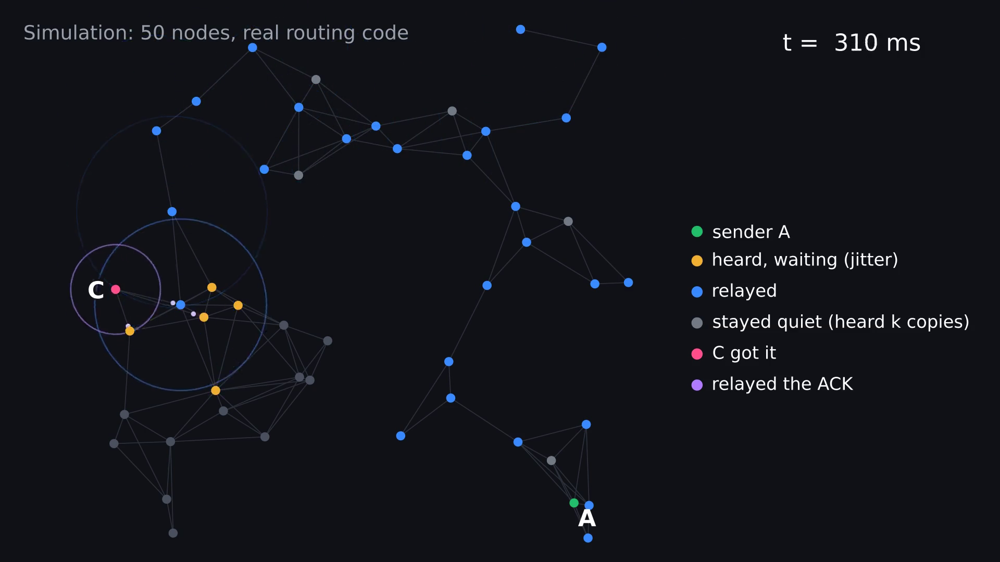
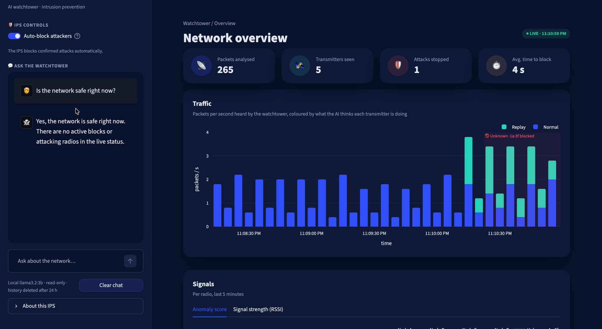
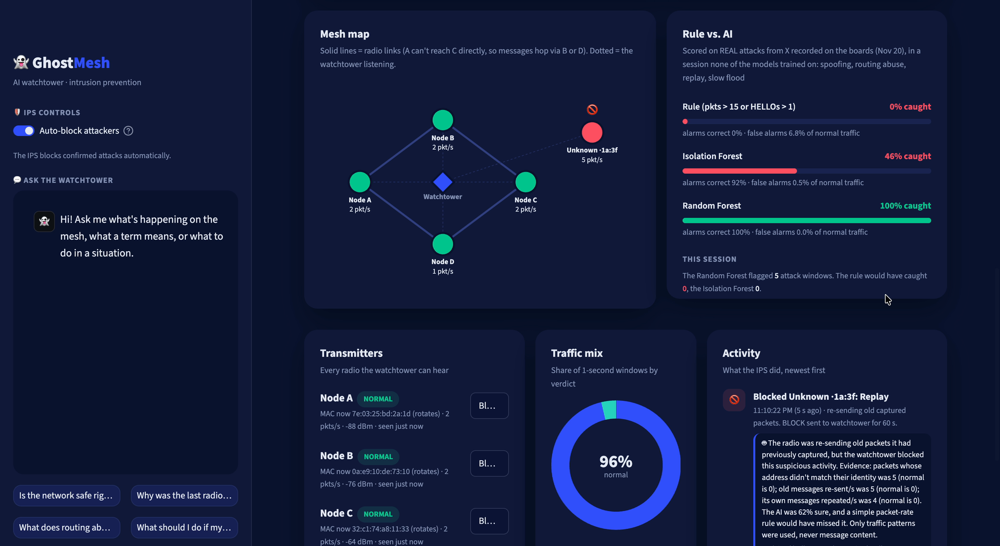
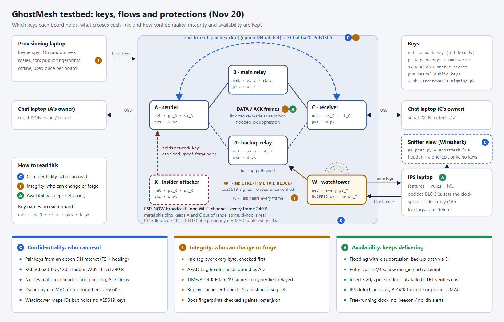
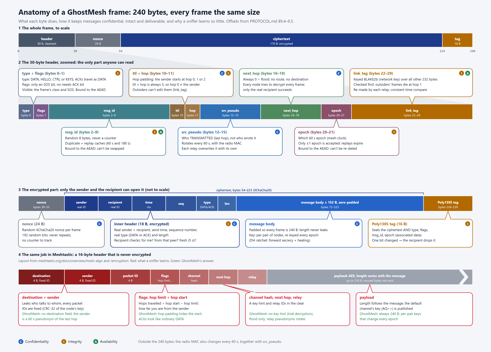
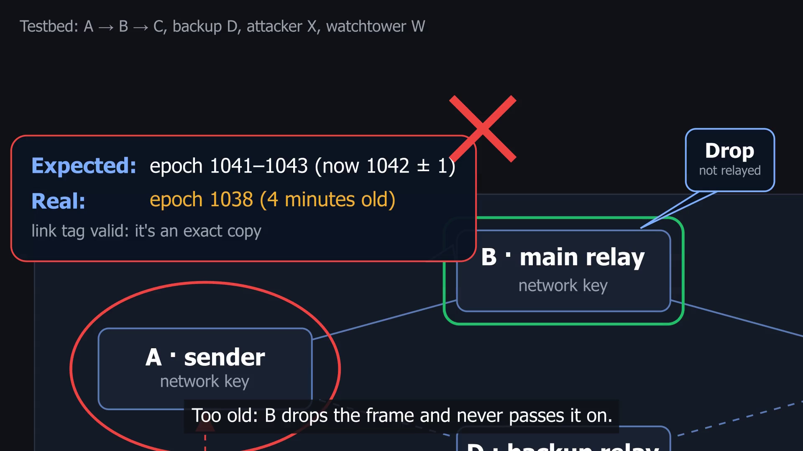

# GhostMesh

**An off-grid, surveillance-resistant mesh network on ESP32-S3, defended by an AI intrusion prevention system.**

> Meshtastic leaks who's talking. We built a mesh protocol that doesn't, and an AI watchtower that catches and blocks attackers inside the network.

Built for **Patriot HackFest Fall 2026**, track **"Life underground"**, problem **#7**: *the Directorate controls the network and can shut it down whenever it wants. How would people organize, share information or call for help without it?*

> **Status:** Submitted. Demo video: [`docs/results/videos/final/GhostMesh_FULL.mp4`](docs/results/videos/final/GhostMesh_FULL.mp4).

---

## The problem

In 2087 the surface is unlivable, and two billion people live in the Hollow, cities carved into old mines and subway tunnels. The Directorate controls the air, movement between levels and the network, and it can cut the network off whenever it wants. Every tower and router it runs is a choke point: it can be switched off, and it logs who talks to whom.

Off-grid meshes like Meshtastic keep working without towers, but their cleartext routing headers still show who is talking to whom, which is exactly what a watching Directorate needs. GhostMesh is the resistance's answer to problem #7: a network the Directorate can't switch off, can't read, and can't map, that also notices and ejects intruders. Because it carries any short message, it also helps with blackout warnings (#1), finding family across levels (#8) and sharing outbreak data the official numbers hide (#9).

## What GhostMesh does

- **Multi-hop messaging with no infrastructure.** Cheap ESP32-S3 boards relay end-to-end encrypted text over ESP-NOW. If A can't reach C, B forwards it.
- **Self-healing by design.** Managed flooding sends every message over every path, so there are no routes to repair: unplug a relay and the next message goes around it (measured on hardware: median 0.97 s, 0 messages lost).
- **Metadata privacy.** The destination never appears in cleartext, sender pseudonyms and Wi-Fi MACs rotate every epoch, and every frame is a fixed 240 bytes.
- **Replay and outsider protection.** A network-key link tag drops outsider frames at the first hop; sequence numbers and timestamps inside the ciphertext stop replays.
- **AI intrusion prevention.** A watchtower node streams traffic metadata to an ML-based IPS that detects spoofing, flooding, replay, and routing abuse, then broadcasts a signed BLOCK so the mesh ejects the attacker.

## Architecture

```
 [Laptop chat]           [Laptop chat]
      │ serial                │ serial
   ┌──┴──┐    ┌─────┐     ┌───┴─┐
   │  A  │────│  B  │─────│  C  │       ← mesh nodes (ESP32-S3, ESP-NOW)
   └──┬──┘    └─────┘     └──┬──┘
      │       ┌─────┐        │
      └───────│  D  │────────┘           ← backup relay (reroute path)
              └─────┘
   ┌──────────────┐  serial   ┌─────────────────────────────┐
   │  Watchtower  │──────────▶│ Laptop: IPS (features → ML) │
   │ (listens all)│◀──────────│ → signed BLOCK broadcast    │
   └──────────────┘           └─────────────────────────────┘
   ┌──────────────┐
   │   Attacker   │  ← red-team node: flood / replay / spoof / routing abuse
   └──────────────┘
```

All boards run the same firmware; the role (`NODE`, `WATCHTOWER`, `ATTACKER`) is set by config.

| Layer | Tech |
|---|---|
| Radio | ESP-NOW (connectionless Wi-Fi frames, 250-byte max payload) |
| Firmware | C/C++ on ESP32-S3, FreeRTOS tasks (Arduino-ESP32 via PlatformIO; W and X on ESP32-WROOM-32E) |
| Crypto | X25519 + XChaCha20-Poly1305, Ed25519-signed BLOCKs (Monocypher 4.0.2) |
| Routing | Managed flooding |
| Simulation | Python discrete-event sim running the real `routing.c` (via `ctypes`), 20–50 nodes |
| IPS | Python: Isolation Forest + Random Forest, rule-based baseline, Streamlit dashboard |
| Analysis | `.pcap` export + Wireshark Lua dissector |

Full protocol spec (frame format, forwarding rules, serial schema): **[PROTOCOL.md](PROTOCOL.md)**

## Repository layout

```
ghostmesh/
├── README.md
├── PROTOCOL.md
├── firmware/            # Node firmware: radio, frame codec, routing, crypto, roles
│   ├── src/
│   └── config/          # Per-board role and keys
├── sim/                 # Network simulator, experiments, plots
├── security/            # Keygen, pcap converter, Wireshark dissector, attacks, threat model
├── ips/                 # Ingest, features, models, dashboard, datasets
├── tools/
│   └── chat_client.py   # Laptop chat over serial
└── docs/                # Diagrams, results, slides, video link
```

## Getting started

> 4× ESP32-S3 Super Mini (A–D), 2× ESP32-WROOM-32E (W, X), USB-C data cables, PlatformIO. Details: [firmware/README.md](firmware/README.md).

### Hardware

| Item | Qty |
|---|---|
| ESP32-S3 dev boards | 4 minimum, 6 ideal |
| USB-C **data** cables | One per board |
| Power banks | 2–3 (so relays can sit apart) |
| Laptops | 2+ (chat client, IPS) |

### Flash the firmware

```bash
python3 security/keygen.py --nodes A,B,C,D,W,X      # once: per-board keys (gitignored)
cd firmware
pio run -e A -t upload --upload-port COM8          # same for B, C, D
pio run -e W -t upload --upload-port COM13         # watchtower (ESP32-WROOM-32E)
# details: firmware/README.md
```

### Run the chat client

```bash
pip install -r requirements.txt
python tools/chat_client.py --port /dev/ttyUSB0   # one per board (A and C)
```

### Run the IPS dashboard

```bash
cd ips && pip install -r requirements-lock.txt
streamlit run dashboard.py                         # http://localhost:8501
python3 live.py --port <watchtower serial port>     # feed it live from W
# details: ips/README.md
```

### Run the simulator

```bash
python3 sim/run.py scaling      # experiments: see python3 sim/config.py
python3 sim/analyze.py scaling  # table + plots in sim/out/figures/
```

## Results

| Metric | Target | Actual |
|---|---|---|
| Delivery rate, A → C via B (50 msgs) | ≥ 95% | **94%** (47/50), Nov 20, A → C relayed by B/D through a wall (RSSI gate −85 dBm on A and C). Counted from ACKs back at A, so a lower bound: just short of the target. [Details](docs/results/hardware-measurements-2026-11-20.md) |
| Reroute time after relay unplugged | ≤ 10 s | **Median 0.97 s, max 4.28 s**, 0 messages lost, 5 trials (§13 asks for 10). Met. [Details](docs/results/hardware-measurements-2026-11-20.md) |
| Replay rejection | 100% | **Not tested on hardware yet** (needs X's `replay` session). Laptop tests: duplicate, 10 s stale and 90 s replayed frames all dropped and not relayed (`firmware/test/test_routing.c`) |
| Encrypt + decrypt time on ESP32-S3 | < 5 ms | **12.7 ms**: encrypt 3.2 ms + trial-decrypt 9.5 ms (1000 runs on A). Missed. Trial-decrypt is ~3× a frame's 3.2 ms airtime, so CPU limits a board before airtime does, at ~100 frames/s. [Details](docs/results/hardware-measurements-2026-11-20.md) |
| Detection time per attack (ML) | ≤ 5 s | **Not measured on hardware yet** (needs X). Design: 2 s to decide + up to 3 s for W to send the BLOCK. Laptop run of the demo flood (real node + watchtower code, `test_node.c` Demo 2, fed to `ips/live.py`): BLOCK after ~2 s |
| IPS recall / FPR (ML vs. rules) | ML ≥ rules | **Met on synthetic attacks:** Random Forest 99% recall / 0.0% FPR vs. rules 37% / 8.9% (Isolation Forest 62% / 0.9%). Real hardware, no attacks: 0 false alarms in 654 windows (Nov 18) and 1,231 (Nov 17). Real attack recall still to come from X. [IPS results](ips/README.md#results) |
| Sim: transmissions per delivered msg, flooding vs. route learning (50 nodes) | Route learning lower | Lower, but not deployed: 88.9 → 79.1 with random pairs (−11%), 90.7 → 64.9 with 5 conversations (−28%). See [sim results §7](docs/results/sim-results.md) |

## Screenshots

**Simulation: one message crossing a 50-node mesh.** A replay of a real `scaling` run through the actual `routing.c`, 310 ms in, as C receives the message. Blue nodes relayed it, grey nodes stayed quiet after hearing k = 2 copies, orange nodes are still waiting out their jitter.



**IPS: a replay attack caught live.** The watchtower dashboard on Nov 20 with the real boards: X replays captured frames (green bars), and the IPS blocks it 4 s later.



**IPS: rule vs. AI on real attacks.** The mesh map with the blocked attacker, and how each detector scored on the Nov 20 attacks from X: the simple rule caught 0%, the Isolation Forest 46%, the Random Forest 100%. The activity feed explains the block in plain English.



**Security map: keys, flows and protections.** Which keys each testbed board holds, what crosses each link, and how confidentiality, integrity and availability are kept. The interactive version, with a second view that marks the weak points, is [docs/diagrams/security-map.html](docs/diagrams/security-map.html).



**Anatomy of a 240-byte frame.** What every byte does, which part a sniffer can read, and what Meshtastic's 16-byte cleartext header leaks by comparison. Source: [docs/diagrams/packet-anatomy.svg](docs/diagrams/packet-anatomy.svg).



**Replay attack, dropped at the first hop.** A frame from the replay clip: X re-sends a real frame from A, and B drops it because its epoch is 4 minutes old, even though the link tag is valid.



_Add the rest of the wanted screenshots here._

## Known limitations

- **Range is tabletop-scale.** ESP-NOW reaches many meters, so on one table every board hears every other one, even at minimum TX power. For the demo, multi-hop is forced with three rooms (A, then relays B and D, then C) plus an RSSI gate at −85 dBm on A and C, so A and C really can't hear each other; MAC rotation stays on the whole time. We decided against a MAC allowlist since it would be a security risk.
- **Route learning isn't deployed.** The mesh uses managed flooding. We built a route-learning mode that limits each flood to how far away the recipient is, but any scoped TTL tells a sniffer roughly how far the recipient is, so we kept it off and only use it in the sim to measure what it would save (see [PROTOCOL.md §6](PROTOCOL.md)).
- **MAC-rotating attackers** can try to dodge a block. Per-neighbor rate limits and the link-tag requirement limit this to insiders.
- Keys are pre-provisioned for the demo; there's no in-field key exchange yet.
- Text only, no formal security proofs.

## Future work

- LoRa radios for kilometer-scale range (same protocol, different radio layer)
- Clustered routing with gateway election on hardware
- Store-and-forward to the internet when a node regains connectivity
- Phone app over BLE
- Federated IPS where multiple watchtowers vote before blocking
- Cover traffic to resist timing analysis


## Team

| Role | Focus | Member |
|---|---|---|
| Comp E | Node firmware & hardware | Yunus Hassen |
| Network #1 | Routing & reliability, simulator | Rashad Safir |
| Network #2 | Secure transport, traffic analysis, red team | Jose Perez |
| AI/ML | Intrusion prevention system | Hannan Ahmed |

## License

MIT.
