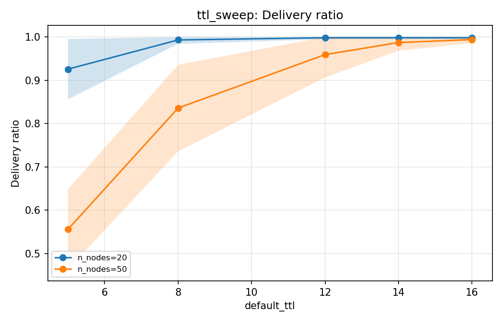
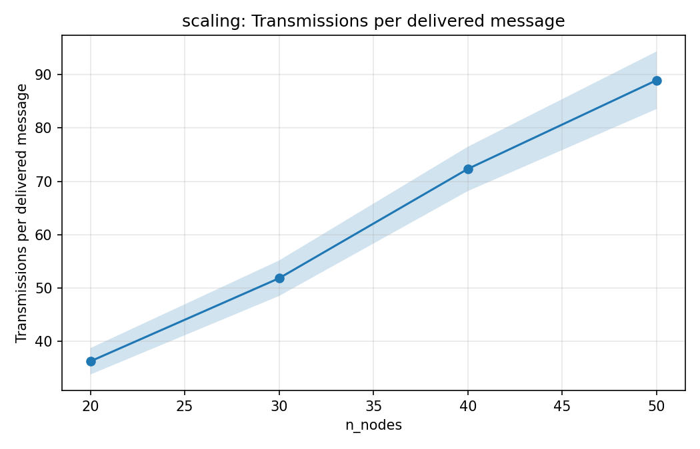
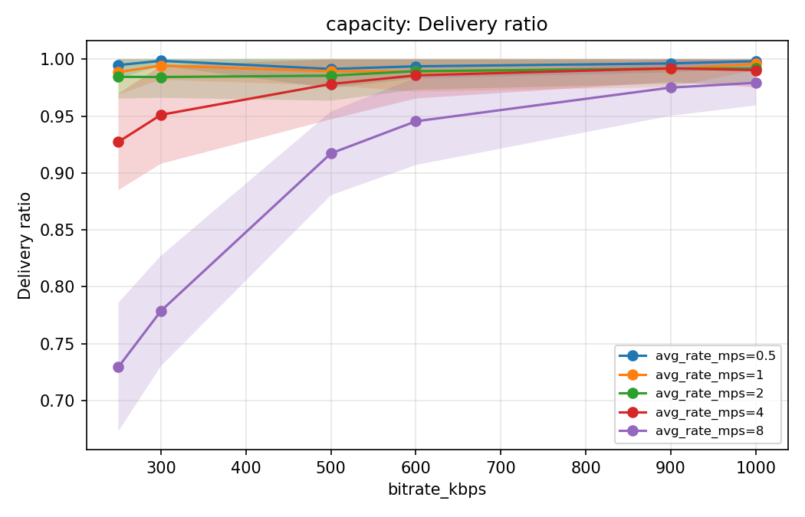
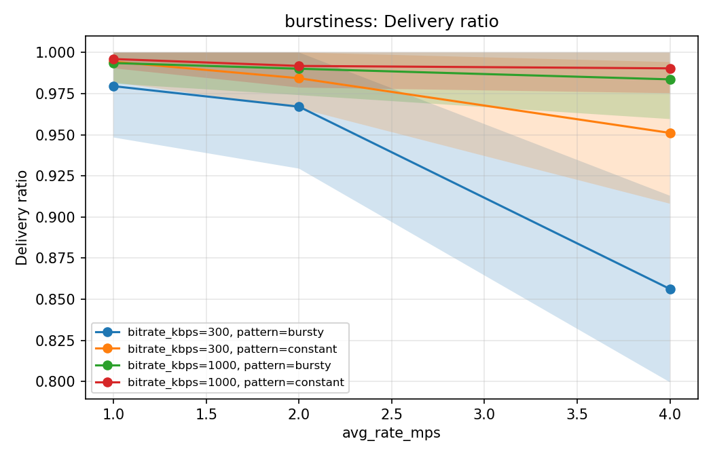
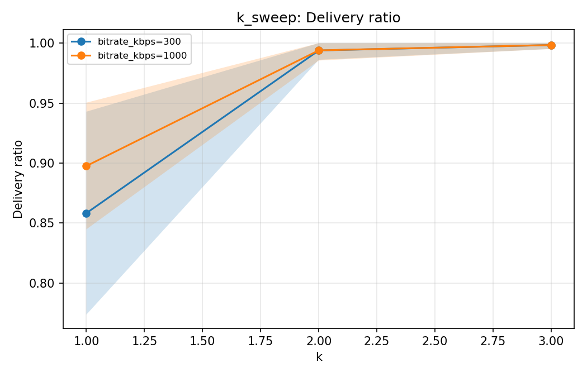
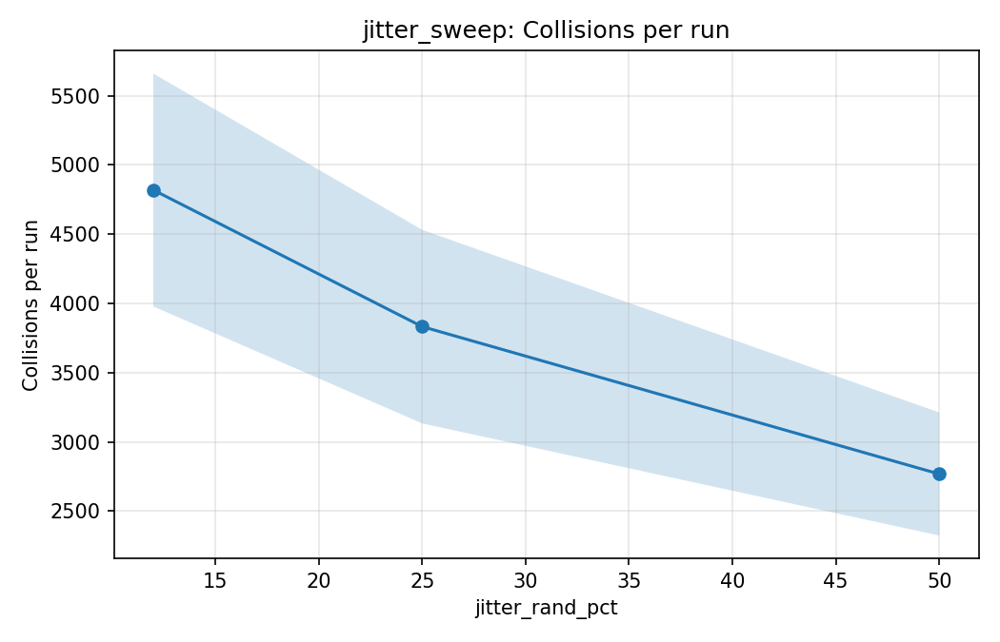

# Simulation results (v1 flooding)

_Owner: Rashad_

These are the results from the Python sim running the real `routing.c` (the same code that goes on the boards). Everything here comes from commit `5eebe0f`. Metric definitions are in `PROTOCOL.md` §13.

All 30 plots are in [`figures/`](figures/). The ones that matter most are shown in each section below.

## How the sim works

The sim builds a random mesh (nodes dropped in a square, linked if they're in radio range) and runs the actual C routing code on every node through `ctypes`. Only the routing is real. The crypto is a stand-in, since we're measuring forwarding, not encryption.

The radio model has:
- **Airtime per frame:** a 192 µs preamble plus (240 + 43) bytes at the channel's bit rate, which is 2.46 ms at 1 Mbps. Yunus measured 2.46 ms on the boards too, so the sim's airtime matches the hardware. 
- **Collisions:** a frame is lost if another frame overlaps it at the receiver, or if the receiver is transmitting at the same time
- **Carrier sense:** a node waits until the channel it hears is quiet, plus a short random backoff

Unless a section says otherwise, every run uses 30 nodes (about 5 neighbors each), a 1000 kbps channel, 1 message/s of random sender→recipient traffic for 120 s (plus 15 s so retries can finish), k = 2, a 50% jitter random share, TTL 16, and 10 seeds per setting. The ± numbers are one standard deviation across seeds.

To rerun any of this:

```bash
python3 sim/run.py <experiment>
python3 sim/analyze.py <experiment>
```

---

## 1. TTL: why the sim uses 16

Delivery in the first runs kept dropping as the mesh got bigger. Was that the protocol, or was TTL too small?

I expected it to be TTL. With the old default of 5 and hop padding taking up to 2 of it, a message could only go 3–5 hops, and a 50-node mesh has paths longer than that. Retries can't help, since every attempt hits the same limit.

**Setup:** `ttl_sweep`, 20 and 50 nodes, TTL 5 / 8 / 12 / 14 / 16.

| Nodes | TTL 5 | TTL 8 | TTL 12 | TTL 14 | TTL 16 |
|---|---|---|---|---|---|
| 20 | 0.926 | 0.993 | 0.998 | 0.998 | 0.998 |
| 50 | 0.556 | 0.836 | 0.959 | 0.987 | **0.994** |



This shows that TTL was the problem. 20 nodes are maxed out by TTL 12 (the 12/14/16 rows are identical because no message ever needs more than 12 hops there), and 50 nodes level off at 14–16. A bigger TTL also costs basically nothing: transmissions per delivered message stay around 89–94 no matter the TTL, since fewer messages fail and burn through all their retries. So the sim uses **16**. This doesn't decide the hardware TTL though, since the 4-board demo only needs about 2 hops.

---

## 2. Scaling: the cost of flooding

Does flooding stay reliable as the mesh grows, and what does it cost?

**Setup:** `scaling`, 20 / 30 / 40 / 50 nodes at the same density.

| Nodes | Delivery | TX per delivered msg | Median latency | Collisions |
|---|---|---|---|---|
| 20 | 0.998 | 36.3 | 54 ms | 1,203 |
| 30 | 0.996 | 51.8 | 64 ms | 2,045 |
| 40 | 0.994 | 72.3 | 88 ms | 2,691 |
| 50 | 0.994 | 88.9 | 122 ms | 2,768 |



This shows that flooding is reliable at every size (≥ 0.994), but the cost grows with the mesh: about **1.8 transmissions per node** for every message delivered. That's roughly one network-wide flood for the DATA and another for the ACK, minus what k-suppression saves. This is the baseline route learning (v2) has to beat, since a learned route should cost about "path length × 2" and stay flat as the mesh grows. Median latency goes up with size too, which makes sense since paths get longer.

---

## 3. Channel capacity: slower channels

What happens on channels slower than ESP-NOW's default 1 Mbps as traffic goes up? (250 and 500 kbps are roughly ESP32 Long Range mode.)

**Setup:** `capacity`, 30 nodes, 250 / 300 / 500 / 600 / 900 / 1000 kbps × 0.5 / 1 / 2 / 4 / 8 messages/s.

| Bit rate | Delivery at 4 msg/s | Delivery at 8 msg/s | Median latency at 8 msg/s |
|---|---|---|---|
| 1000 kbps | 0.990 | 0.979 | 82 ms |
| 600 kbps | 0.986 | 0.945 | 106 ms |
| 500 kbps | 0.978 | 0.917 | 127 ms |
| 300 kbps | 0.951 | 0.779 | 212 ms |
| 250 kbps | 0.927 | 0.730 | 260 ms |



This shows that at light load the bit rate barely matters (everything is ≥ 0.984 up to 2 msg/s). Under heavy load there's a clear knee: below about 500 kbps the channel can't keep up, and at 250–300 kbps with 8 msg/s about a quarter of messages don't make it. The 95th percentile latency sits right at ~7.1 s there with almost no spread, which is 1 + 2 + 4 s of retries, so the slowest messages are using every retry they have.

---

## 4. Bursty vs constant traffic

Real chat is bursty. Does sending in bursts hurt more than sending the same amount evenly?

**Setup:** `burstiness`, 30 nodes, same average load either way. Bursty = 2 s on / 8 s off, so 4 msg/s on average means 20 msg/s during each burst.

| Bit rate | Avg load | Constant | Bursty | Median latency (constant → bursty) |
|---|---|---|---|---|
| 1000 kbps | 4 msg/s | 0.990 | 0.984 | 70 → 96 ms |
| 300 kbps | 2 msg/s | 0.984 | 0.967 | 104 → 169 ms |
| 300 kbps | 4 msg/s | 0.951 | **0.856** | 131 → **754 ms** |



This shows that on the default 1 Mbps channel, bursts barely matter. On a slow channel they do: the average load looks fine, but 20 msg/s during a burst is more than 300 kbps can carry, so messages pile up and collide. A test that only looks at average load would call 300 kbps fine, which it isn't.

---

## 5. Suppression threshold k

How many duplicate copies should a node hear before cancelling its relay? This is the coverage hole problem from the Nov 15 decision: with k = 1, a node whose only path runs through a cancelled relay never gets the message.

**Setup:** `k_sweep`, 50 nodes, k = 1 / 2 / 3 at 300 and 1000 kbps.

| | k = 1 | k = 2 | k = 3 |
|---|---|---|---|
| Delivery, 300 kbps | 0.858 | 0.994 | 0.998 |
| Delivery, 1000 kbps | 0.898 | 0.994 | 0.998 |
| p95 latency, 300 kbps | 7,192 ms | 1,976 ms | 978 ms |
| TX per delivered, 1000 kbps | 72.6 | 88.9 | 96.4 |
| Collisions, 1000 kbps | 1,636 | 2,768 | 3,623 |



This shows that k = 1 loses 10–14% of messages, which backs up the coverage hole fix with real numbers. k = 3 does cut tail latency in half (fewer relays get cancelled, so there are more backup copies), but it costs about 8% more transmissions and 31% more collisions. Since collisions matter more to us than tail latency, **k = 2** is the default. k = 3 is still a fair option if tail latency ever matters more.

One more thing: k = 1 did better here (0.858 at 300 kbps) than it did with the old 25% jitter share (0.786). That's because more randomness means the same node doesn't always relay first, so the jitter partly covers coverage holes on its own.

---

## 6. Jitter random share

How much of the jitter window should be random versus based on RSSI? (See `PROTOCOL.md` §5.3.)

**Setup:** `jitter_sweep`, 50 nodes, 1000 kbps, 12 / 25 / 50% random.

| Random share | Delivery | TX per delivered | Median latency | Collisions |
|---|---|---|---|---|
| 12% | 0.991 | 94.5 | 89 ms | 4,820 |
| 25% | 0.995 | 91.3 | 98 ms | 3,832 |
| 50% | 0.994 | 88.9 | 122 ms | **2,768** |



This shows that more randomness keeps nodes with similar signal strength from transmitting at the same moment. Going from 12% to 50% cuts collisions by 43% with the same delivery, for about 33 ms more median latency. Collisions matter more to us, so the default is now **50%**. The 20 ms random part is still 2–3 frame airtimes even at 300 kbps, so the §5.3 timing rule still holds on slow channels. This sweep only ran at 1000 kbps though.

---

## Limitations

- **Crypto is a stand-in.** The sim doesn't model encryption time or KEYS / CTRL traffic, so real meshes will carry a bit of extra background traffic.

- **The radio model is simple.** Collisions are all-or-nothing (no capture effect), and the RSSI path-loss numbers are estimates. Airtime is checked against the boards (2.46 ms at 1 Mbps, and every frame on the boards went out at 1 Mbps). The boards’ airtime_avg_us counter reads higher (~3.2–3.3 ms) because it times esp_now_send to the send callback, which includes waiting for the channel. The sim models that wait separately with carrier sense.

- **Collisions are counted per reception,** so one transmission heard by 5 neighbors can count up to 5 times. Compare them across settings, not as absolute numbers.

- **Latency is quantized by retries.** The 95th percentile mostly reflects how many retries the slowest messages needed (1 s / 2 s / 4 s).

- **Random topologies only.** No walls, no moving nodes, and nodes are spread evenly in a square.

## All figures

Every experiment has five plots in [`figures/`](figures/): `<experiment>_delivery_ratio.png`, `_tx_per_delivered.png`, `_latency_ms_median.png`, `_latency_ms_p95.png`, and `_collisions.png`, for `scaling`, `capacity`, `burstiness`, `k_sweep`, `jitter_sweep`, and `ttl_sweep`.
